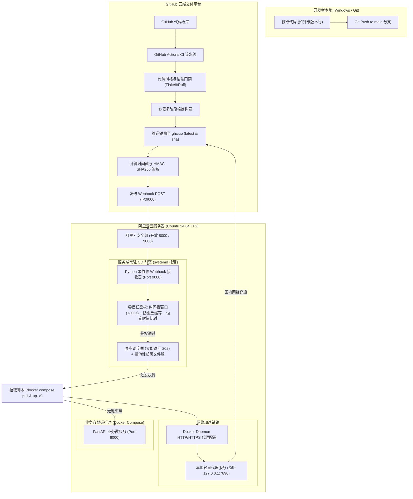

# 现代云原生轻量 GitOps 自动化发布平台实施计划与工程规范文档

> **文档定位**：本项目规划文档供开发人员与 AI 协同执行使用。文档规范了从基础设施初始化、网络调优、微服务开发、云端 CI 构建到服务端轻量 CD 引擎落地的全流程，支持上下文无缝衔接与逐步执行。

---

## 1. 项目全局架构与技术规范

### 1.1 系统架构拓扑图



### 1.2 关键运行环境与技术栈参数

| 模块 | 技术选型 | 配置/版本规范 | 备注说明 |
| :--- | :--- | :--- | :--- |
| **云服务器宿主机** | 阿里云 ECS | Ubuntu 24.04 LTS (2 vCPU, 2 GB RAM, 40 GB 磁盘, 100 Mbps 带宽) | 资源紧凑，全流程注重轻量化与低开销 |
| **容器引擎** | Docker CE + Docker Compose Plugin | Docker v26+ | 配置非 root 运行组与日志上限策略 |
| **业务应用框架** | Python FastAPI + Uvicorn | Python 3.12-slim | 提供 `GET /`（版本与状态）与 `GET /health` |
| **镜像托管仓库** | GitHub Packages (ghcr.io) | Public Visibility | 命名规范：`ghcr.io/<owner>/<repo>:<tag>` |
| **云端 CI 引擎** | GitHub Actions | Ubuntu-latest 运行器 | 实现语法门禁、自动化推送与安全 Webhook 发送 |
| **服务端 CD 引擎** | 自研 Python 标准库脚本 | 无第三方依赖 | 监听 9000 端口，包含防重放与异步文件锁 |
| **网络加速组件** | Mihomo (Clash-meta) 核心 | Systemd 托管 (127.0.0.1:7890) | 通过订阅链接打通 ghcr.io 镜像高速拉取 |

---

## 2. 通信安全与防重放协议规范（Security Protocol）

为了在纯 HTTP 裸公网暴露（端口 9000）场景下实现银行级通信安全，制定如下零信任安全鉴权协议：

### 2.1 请求头与加密报文规范

* **请求方式**：`POST http://<SERVER_IP>:9000/webhook`
* **Content-Type**：`application/json`
* **自定义安全请求头**：
  * `X-Timestamp`：发送请求时的 UTC Unix 秒级时间戳（例如 `1730800000`）。
  * `X-Signature-256`：使用共享密钥对报文计算的签名值：
    $$\text{X-Signature-256} = \text{HMAC-SHA256}(\text{Secret}, \text{Timestamp} + \text{Body})$$
* **请求体 Payload 样例**：
  ```json
  {
    "event": "push",
    "repository": "gitops-demo",
    "ref": "refs/heads/main",
    "commit": "a1b2c3d4e5f6...",
    "image_tag": "latest"
  }
  ```

### 2.2 接收端鉴权防重放防御逻辑（Receiver Logic）

1. **时钟偏差校验（Clock Skew Check）**：
   * 接收端提取 `X-Timestamp`，比对当前宿主机 UTC 时间：
     $$|\text{Time}_{\text{current}} - \text{Timestamp}| \le 300\text{ 秒 (5分钟)}$$
   * 若超出 $\pm 300\text{s}$，判定请求过期或存在中间人重放，直接返回 `403 Forbidden`。
2. **防重放内存缓存（Nonce/Signature Deduplication）**：
   * 维护一个保存近 5 分钟内已处理签名的内存 LRU/集合结构。
   * 若收到的 `X-Signature-256` 已存在于缓存中，立即拦截并记录安全审计日志，返回 `403 Forbidden`。
3. **恒定时间签名比对（Constant Time Compare）**：
   * 接收端使用配置的 `WEBHOOK_SECRET` 本地计算哈希值，通过 `hmac.compare_digest` 恒定时间算法与请求头比对，免疫时序攻击（Timing Attack）。

---

## 3. 服务器标准目录与配置规划

服务器统一根工作目录设定为：`/opt/gitops-app`

```
/opt/gitops-app/
├── cd-receiver/                  # 服务端 CD 接收引擎
│   ├── receiver.py               # 纯标准库常驻 HTTP 接收脚本
│   └── deploy.sh                 # 实际调度 docker compose 更新的脚本
├── docker-compose.yml            # 业务容器编排描述文件
└── logs/                         # 部署与安全审计日志目录
    └── deploy.log
```

---

## 4. 全流程分阶段实施任务卡（AI / 人类协同执行指南）

---

### 阶段一：基础设施准备与网络调优（云服务器端）

* **前置条件**：具备公网 IP 的 Ubuntu 24.04 LTS 服务器 SSH 登录凭证，现成代理订阅链接。
* **执行角色**：AI 提供生产级 Shell 指令与配置，用户在服务器终端执行。

#### 任务清单
1. **任务 1.1【阿里云安全组策略加固】**
   * 入方向规则放行：
     * TCP `8000`（业务 API 访问端口，授权对象：`0.0.0.0/0`）
     * TCP `9000`（CD 接收通知端口，授权对象：`0.0.0.0/0`）
     * TCP `22`（管理 SSH 端口，仅限自身 IP 或安全范围）
2. **任务 1.2【Docker 运行时就绪】**
   * 卸载旧组件，通过官方源安装最新 Docker Engine 与 Compose 插件。
   * 配置 Docker 开机自启，将当前用户加入 `docker` 组免 sudo 执行。
3. **任务 1.3【本地透明代理服务部署】**
   * 编写一键部署脚本，下载 Mihomo (Clash-meta) Linux-amd64 轻量核心至 `/usr/local/bin/mihomo`。
   * 通过用户的订阅链接拉取节点配置文件并存放在 `/etc/mihomo/config.yaml`（混合监听 `127.0.0.1:7890`）。
   * 创建 `/etc/systemd/system/mihomo.service`，启动并设置开机自启。
4. **任务 1.4【Docker Daemon 代理注入与网络验证】**
   * 创建 `/etc/systemd/system/docker.service.d/http-proxy.conf`，写入：
     ```ini
     [Service]
     Environment="HTTP_PROXY=http://127.0.0.1:7890"
     Environment="HTTPS_PROXY=http://127.0.0.1:7890"
     Environment="NO_PROXY=localhost,127.0.0.1,localaddress,.localdomain.com"
     ```
   * 重载并重启 Docker：`systemctl daemon-reload && systemctl restart docker`。
   * **连通性验收**：在服务器终端执行 `docker pull ghcr.io/linuxserver/baseimage-alpine:latest` 测试代理链路通畅。

* **阶段交付标准 (DoD)**：服务器无需额外梯子即可通过 Docker 高速从 `ghcr.io` 成功拉取镜像。

---

### 阶段二：业务设计与仓库工程规划（本地工作区）

* **前置条件**：本地工作区 `C:\gitops`，本地已安装 Git。
* **执行角色**：AI 编写代码与编排规范，用户 review 并推送到 GitHub。

#### 任务清单
1. **任务 2.1【FastAPI 轻量业务应用工程】**
   * 创建应用代码结构：
     * `app/main.py`：
       * 路由 `GET /`：返回 `{"status": "healthy", "version": "v1.0.0", "environment": "production"}`
       * 路由 `GET /health`：返回 `{"status": "ok"}`（用于容器健康检查）
     * `requirements.txt`：仅声明 `fastapi` 与 `uvicorn[standard]`
2. **任务 2.2【生产级 Dockerfile 编写】**
   * 基础镜像选用 `python:3.12-slim`。
   * 规划规范的层级缓存：先 COPY `requirements.txt` 并安装依赖，再 COPY 业务源码，最大化利用 Docker build 缓存。
   * 设置非 root 容器运行用户，增加安全性。
3. **任务 2.3【本地编排模型与日志防护】**
   * 编写 `docker-compose.yml`：
     * 镜像名动态指向 `ghcr.io/<owner>/<repo>:latest`。
     * 容器重启策略：`restart: unless-stopped`。
     * 日志轮转限制（防止磁盘写满）：
       ```yaml
       logging:
         driver: "json-file"
         options:
           max-size: "10m"
           max-file: "3"
       ```
     * 健康检查指令：基于 Python 标准库调用容器内 `http://127.0.0.1:8000/health`。

* **阶段交付标准 (DoD)**：本地代码结构完备，Docker 镜像可在本地正常构建运行并通过健康检查。

---

### 阶段三：云端 CI 自动化流水线搭建（GitHub Actions 交付层）

* **前置条件**：GitHub 个人或组织新建公开仓库 `gitops-demo`，拥有公网 IP 与预共享秘钥。
* **执行角色**：AI 提供 `.github/workflows/ci-cd.yml` 配置，用户在 GitHub 仓库中录入 Secrets。

#### 任务清单
1. **任务 3.1【代码质量门禁编排】**
   * 在 GitHub Actions 中配置第一阶段任务：检出代码，安装 Python，运行 `flake8` 或 `ruff` 进行语法及 PEP8 规范校验。
2. **任务 3.2【ghcr.io 自动打包与多标签推送】**
   * 配置 `docker/login-action`，使用 `${{ secrets.GITHUB_TOKEN }}` 登录 `ghcr.io`（工作流需申请 `packages: write` 权限）。
   * 配置 `docker/build-push-action`，打上双标签：
     * `ghcr.io/<owner>/<repo>:latest`
     * `ghcr.io/<owner>/<repo>:${{ github.sha }}`
3. **任务 3.3【安全凭据集中托管 (GitHub Secrets)】**
   * 在 GitHub 仓库 `Settings -> Secrets and variables -> Actions` 中配置：
     * `SERVER_IP`：云服务器公网 IPv4 地址
     * `SERVER_PORT`：`9000`
     * `WEBHOOK_SECRET`：强随机生成的预共享密钥（如 32 位 Hex 随机串）
4. **任务 3.4【安全 Webhook 触发通知编排】**
   * 编写流水线最后一步（通知下发）：通过 Python 或 Shell 脚本实时获取 UTC 时间戳，计算 `HMAC-SHA256` 签名，通过 `curl` 向 `http://${SERVER_IP}:${SERVER_PORT}/webhook` 投递通知。

* **阶段交付标准 (DoD)**：推送代码至 main 分支后，流水线全绿，`ghcr.io` 产生对应镜像包，且流水线成功向服务器发送加密 Webhook。

---

### 阶段四：服务端 CD 接收服务与系统守护（服务端控制层）

* **前置条件**：服务器 `/opt/gitops-app` 目录就绪，安全组 9000 端口已放行。
* **执行角色**：AI 提供完整的接收脚本与 systemd 单元文件，用户在服务器部署并启动守护。

#### 任务清单
1. **任务 4.1【自研零依赖 Webhook 接收脚本 (`receiver.py`)】**
   * 基于 Python 标准库 `http.server` 构建多线程/异步非阻塞 HTTP 接收器。
   * 从请求头提取 `X-Timestamp` 与 `X-Signature-256`。
2. **任务 4.2【零信任防重放引擎实现】**
   * 校验时间戳是否在 $\pm 300\text{s}$ 内。
   * 检查签名是否已在去重集合中；将处理过的签名记录入缓存并自动淘汰过期项。
   * 调用 `hmac.compare_digest` 验证签名真实性。
3. **任务 4.3【异步更新调度器与部署排他锁 (`deploy.sh`)】**
   * 鉴权通过后，立即向客户端返回 `HTTP 202 Accepted`，断开连接避免 Actions 超时。
   * 后台异步触发 `/opt/gitops-app/cd-receiver/deploy.sh`。
   * 在 `deploy.sh` 中使用 Linux `flock` 命令实现排他文件锁：
     ```bash
     exec 200>/var/run/gitops-deploy.lock
     flock -n 200 || { echo "Another deployment is in progress. Exiting."; exit 1; }
     ```
   * 调度核心执行命令：
     ```bash
     cd /opt/gitops-app
     docker compose pull
     docker compose up -d --remove-orphans
     docker image prune -f
     ```
4. **任务 4.4【Linux Systemd 守护进程注册】**
   * 创建服务配置 `/etc/systemd/system/gitops-cd.service`：
     * 配置以合适权限运行，定义崩溃自愈规则 `Restart=on-failure` 与 `RestartSec=5s`。
     * 环境变量安全注入 `WEBHOOK_SECRET`。
   * 启动服务并验证：`systemctl daemon-reload && systemctl enable --now gitops-cd`。

* **阶段交付标准 (DoD)**：`systemctl status gitops-cd` 为 active (running)，本地 `curl` 发送非法伪造请求被正确拒绝并记录日志。

---

### 阶段五：全链路集成与端到端发布验证（实战演练与简历加分）

* **前置条件**：阶段一至四已全部就位。
* **执行角色**：用户主导触发与观测，AI 协助排错与日志诊断。

#### 任务清单
1. **任务 5.1【手工基准版本首发】**
   * 在服务器 `/opt/gitops-app` 执行一次初始化启动，验证 `http://<SERVER_IP>:8000/` 与 `http://<SERVER_IP>:8000/health` 返回 `v1.0.0`。
2. **任务 5.2【全自动 GitOps 触发演练】**
   * 本地将代码版本号修改为 `v1.0.1`，通过 `git commit -am "chore: bump version to v1.0.1"` 并 `git push origin main`。
   * 观察 GitHub Actions 自动流转。
3. **任务 5.3【服务端生命周期日志审计】**
   * 在服务器端运行 `journalctl -u gitops-cd -f`，实时观察：
     * 收到来自 Actions 的 Webhook 请求。
     * 时间戳与 HMAC-SHA256 签名校验成功。
     * 立即响应 202，触发后台部署子进程。
     * Docker Compose 成功拉取最新镜像并重启容器。
4. **任务 5.4【业务无缝生效验证】**
   * 访问 `http://<SERVER_IP>:8000/`，确认返回结果已无缝自动变成 `v1.0.1`。
5. **任务 5.5【安全防御实测（面试经典排错素材）】**
   * 手工用 curl 模拟伪造请求（不带签名、错误签名、过期时间戳），确认接收器全部正确拒绝（401/403）并审计记录，不触发 Docker 更新。

* **阶段交付标准 (DoD)**：全链路无需人工登录服务器，Git push 后两分钟内业务自动更新生效，安全防护测试 100% 达标。

---

## 5. 面试高频问题与技术亮点备忘（Interview Cheatsheet）

| 面试考察点 | 为什么这么做？如何回答？ |
| :--- | :--- |
| **为什么不用 K8s + ArgoCD？** | “在单机或边缘计算场景下，K8s 自身控制面会消耗 1GB+ 内存，对 2GB 内存实例而言属于过度设计。自研轻量 Webhook CD 架构内存占用仅不到 20MB，同样实现了声明式 GitOps、版本镜像化追踪与自动化交付，投入产出比极高。” |
| **公网 HTTP 明文传输，怎么保证安全？** | “基于零信任安全模型，引入了类似 GitHub Webhook 标准的 HMAC-SHA256 签名机制与时间戳窗口。签名由共享密钥生成，拦截者即使抓包也无法篡改 Payload。同时配合 $\pm 300\text{s}$ 时间窗与 Nonce 缓存，彻底防御重放攻击与时序攻击。” |
| **开发者手抖连续 Push 触发多次 CI，服务器会崩吗？** | “不会。我们在 Webhook 接收端采用了‘异步立即返回 202 Accepted + 部署排他锁（flock）’的设计。即使多个 Webhook 几乎同时到达，排他锁保证了同一时刻只有一个 `docker compose` 在执行拉取和容器替换，其余并发请求自动防抖拦截。” |
| **国内服务器拉取海外 ghcr.io 超时怎么解决的？** | “在云服务器上部署了轻量级代理核心，并通过 systemd 的 Environment 文件为 Docker Daemon 注入了 `HTTP_PROXY` 与 `HTTPS_PROXY`，实现容器引擎级别的网络加速，保证自动化交付的高可用性。” |
